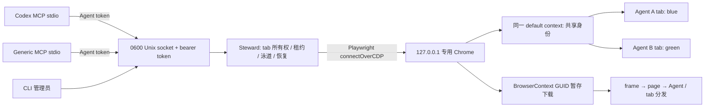

# cdp-browser-steward

一个 Node.js 22+ / TypeScript 的本机浏览器编排工具。多个 Codex / 通用 MCP client 共用专用 Chrome 的 **default BrowserContext**，共享 cookie、localStorage 等身份状态，每个 Agent 只持有自己的 tab 和泳道 header。服务持有一个 `about:blank` anchor tab，保证 Mac 有头 Chrome 在 Agent tab 全部关闭时仍保留同一个窗口/下载管理生命周期；stop 时一并关闭，误关 anchor 会重建浏览器并作废租约。所有浏览器操作通过 Playwright `connectOverCDP`，没有自研 CDP 传输协议。

**v0.1 的明确规则：禁用 SharedWorker；拦截所有 ServiceWorker 所属请求和注册脚本。** 不保留 SW 离线缓存、后台同步、push 等功能；依赖这些能力的业务不适用本模式。不能把同 origin 的共享 worker 当成每 tab 的独立对象。普通 HTTP(S) 页面可以在同一 origin 同时运行不同泳道。

## 架构与边界



这是可信 Agent 之间的操作隔离，不是针对恶意同一 Unix 用户的安全沙箱。能读取管理员文件或直连 CDP 的进程拥有整个浏览器权限，不应给不可信租户。Cookie/localStorage/IndexedDB/缓存等 origin 状态有意共享，泳道 header 隔离不等于业务数据隔离。应用若把泳道结果写入共享存储，仍需自身设计隔离。

- `src/steward.ts`：tab 租约、泳道 header、请求策略、工具动作、健康恢复。
- `src/runtime.ts`：专用 Chrome 进程组、磁盘守卫、轮转 JSONL 日志。
- `src/downloads.ts`：Browser download 事件、frame 所有权、GUID 暂存和完成后分发。
- `src/broker.ts`：本机控制面、管理员与 Agent token、身份校验。
- `src/mcp.ts` / `src/cli.ts`：MCP stdio 工具 / CLI。
- `spike/`、`test/`、`evidence/`：真实 Chrome spike、自动化合成站与请求级验收记录。

## 安装与 Mac 有头运行

需要已有 Node.js 22+、npm、Chrome；不会自动安装浏览器、Xvfb、字体或其他系统依赖。仓库公开，可直接克隆。

```zsh
git clone https://github.com/Tsutomu-miku/cdp-browser-steward-tsutomu.git
cd cdp-browser-steward-tsutomu
npm ci
npm run build
cp examples/config.json /tmp/steward-config.json
node dist/cli.js launch --config /tmp/steward-config.json --headed
node dist/cli.js open --config /tmp/steward-config.json --agent login --lane default --url https://example.com
node dist/cli.js status --config /tmp/steward-config.json
```

将 `example.com` 改为自己的授权测试站，人工在这个专用窗口登录一次。其他 Agent 的 tab 会共享同一份身份。不要指向日常 Chrome profile，也不要用真实个人登录态尝试未经授权的业务环境。人工登录期间保持 `login` tab 的租约（默认五分钟），可用 `renew --agent login --tab <UUID>` 延长。

也可从 git 安装或本地用 npm bin：

```zsh
npm install --global git+https://github.com/Tsutomu-miku/cdp-browser-steward-tsutomu.git
cdp-browser-steward --help
# 在源码目录：
npm exec -- cdp-browser-steward status --config /tmp/steward-config.json
# 验证本地打包；禁止执行 npm publish
npm pack
```

`private: true` 防止意外发布。包只包含 `dist/`、`examples/` 和 README，不包含运行目录、测试 profile 或 cookie。Git 安装的 `prepare` 会编译 TypeScript。若本机 npm 的 allow-scripts 策略阻止 prepare，使用上面的 clone → npm ci → npm run build，再通过 node / npm exec 本地运行；本文没有修改用户全局脚本许可。

## CLI 与泳道

```zsh
node dist/cli.js open --config /tmp/steward-config.json --agent codex --lane blue --headers '{"x-custom":"value"}' --url https://example.com
node dist/cli.js open --config /tmp/steward-config.json --agent agent-b --lane green --url https://example.com
node dist/cli.js status --config /tmp/steward-config.json
node dist/cli.js close --config /tmp/steward-config.json --agent codex --tab <UUID>
node dist/cli.js reclaim --config /tmp/steward-config.json --agent agent-b
node dist/cli.js reconnect --config /tmp/steward-config.json
node dist/cli.js stop --config /tmp/steward-config.json
```

`launch` 启动脱离当前终端的 supervisor；重复启动会返回已有服务健康状态。`serve` 为前台模式，适合 systemd/Xvfb/排错。清理句柄是 `stop --config <同一配置>`；它停止自己的 Chrome 进程组、清理 socket/lock/tab/CDP 连接，保留专用 profile、完成下载与日志。不会杀其他 Chrome。supervisor 被强杀后的下次 launch 会验证旧专用 CDP 的 user-data-dir 与启动标记，再关闭其遗留 Chrome；身份核验失败即报错，不会按任意 PID 杀进程。

配置使用 `examples/config.json` 的 schema，拒绝未知字段。`stateDir` 必须专用，Unix socket 完整路径最长 100 字节；首次启动拒绝非空且未标记的 profile。默认 stateDir 为 `~/.local/state/cdp-browser-steward`；示例中的 `/tmp` 适合演示，长期身份应改为受权限保护的持久目录。`executablePath` 可显式指定 Chrome。`cdpPort: 0` 让 Chrome 选择独立端口，默认端口为 9229。

每次工具操作会续租；空闲到期、原生关闭 tab、`browser_close`、MCP 退出、`reclaim` 都释放 tab 所有权与相关 frame/CDP 映射。MCP 崩溃没有自动续租，到期后回收。忙碌操作以 action timeout 为上限，不在执行中强制回收。外部新建 tab 的网络请求因无归属被拒绝，并在健康扫描时关闭；弹窗也会关闭，需要用 `browser_tabs` 显式新建。

`page.setExtraHTTPHeaders` 给页面及其子 target 设置 header，context route 再根据所属 page 强制合并泳道 header（也覆盖网页自行传入的冲突值）。禁止用泳道模板设置 Cookie、Authorization、Host 等身份或 hop-by-hop header；可配置 `x-lane`、`x-environment` 及其他合法 KV。Header 在该 tab 的 HTTP(S) 跨 origin 请求也会携带，只应打开受信任站点。

本版本的请求覆盖验收范围是 document/css/js/img/fetch/xhr/导航/同源与跨 origin iframe/DedicatedWorker/嵌套 worker/beacon/下载。WebSocket 握手、WebTransport、浏览器扩展自己的网络、浏览器系统请求不在本版本泳道验收范围内。缓存由 route 禁用；不缓存跨泳道响应。

## SharedWorker / ServiceWorker 策略（代码执行）

1. Chrome 固定带 `--disable-shared-workers`；启动时核对 CDP 命令行与专用 user-data-dir。SharedWorker 构造不可用，脚本不加载。
2. default context 安装 route **早于任何受管 tab 导航**。`request.serviceWorker()` 非空，或 `Service-Worker: script` / `Sec-Fetch-Dest: serviceworker/sharedworker` 的请求，一律 `abort('blockedbyclient')`，包括 SW 注册脚本、更新与后台 fetch。
3. 启动发现已有 web SW 会拒绝服务，避免保留无法按 tab 归属的 origin 全局状态。Chrome 自带的 `chrome-extension:` worker 不属于站点 origin；关闭扩展相关启动开关，且不宣称它们受 tab 泳道保证。
4. 不支持给其他人已运行的日常 Chrome 挂上本服务。本 CLI 管理自己的专用 Chrome；多个 MCP client 连接同一 supervisor，再由其 CDP 连接共享实例。
5. CDP 连接丢失时拒绝工具操作，停止自己的 Chrome，清空旧租约，以同一个专用 profile 启动全新页面，再装策略。请求失联到进程停止之间的在途请求不能追溯撤销；不要把它当成抵御恶意浏览器的网络防火墙。原 tab 不恢复，Agent 应 list/new 获取新 tab。每次工具动作后和健康扫描时，在内存更新 cookie 快照，连接恢复后补回会话 cookie；快照后的在途 cookie 更新可能丢失，supervisor 本身退出后内存快照不保留。

如业务必须保留 SharedWorker/SW，后续需要独立实现“同 origin 同时段单泳道”的调度、后台 worker 生命周期和所有请求链路验收；当前没有隐藏的启用开关，也不声称能无条件并行。

## 下载、磁盘与日志

Chrome 下载目录属于 BrowserContext。工具使用 default context 的 CDP GUID（协议未提供时使用专用存储 GUID），设置 `Browser.setDownloadBehavior(allowAndName)`，下载先进入：

```text
stateDir/downloads/staging/<context-guid>/<download-guid>
stateDir/downloads/agents/<agent-id>/<tab-id>/<download-guid>-<safe-name>
```

`Browser.downloadWillBegin.frameId` 经 frame→page→Agent 映射确定归属；完成事件后先核对 CDP 报告的文件路径必须是对应 GUID 暂存路径，再原子移动；违反路径契约即停止分发并恢复浏览器。重复终态事件不会重复移动或删除正在分发的文件。未知 frame 或磁盘受限的下载被取消。文件名去除路径和特殊字符；同名文件使用不同 GUID。MCP 只列本 Agent 下载。Chrome 的默认下载偏好也固定在专用 stateDir 内，避免默认策略意外落到系统 Downloads。tab 释放时取消它未完成的下载。下载记录是当前 supervisor 生命周期内的完成记录；磁盘文件跨进程保留。

启动/开 tab 前检查可用空间，运行中每秒检查可用空间与下载总量；超限拒绝新请求/操作，禁用下载并取消活动下载。默认空闲至少 512 MiB、下载总量 1 GiB；检查间隔内单个下载可能超出软阈值，硬配额请用服务器文件系统。空间恢复后自动解除限制，不自动删除已完成文件或身份数据。

`stateDir/events.jsonl` 是结构化事件日志，轮转为一份 `.1`；默认每份 5 MiB。记录 Agent、tab、lane、header 指纹、请求类型和 header 命中，不记录 cookie、header 值或 URL query/hash。URL 路径仍可能敏感，应保护日志目录。`status` 包含当前占用与健康状态；MCP stdout 只输出协议数据。

## Codex / 通用 MCP 接入（配置示例，未在 IDE 内验收）

先启动共享 supervisor。每个 MCP 配置用不同 `--agent`，`--lane` 对应同一 config。MCP 使用熟悉的 `browser_navigate(url)`、`browser_click(element, ref)`、`browser_type(element, ref, text, submit?, slowly?)`、`browser_snapshot()`、`browser_extract(selector?)`；snapshot 是 Playwright AI accessibility tree，点击可使用其中真实 ref；selector 是扩展参数。辅助工具有 `browser_tabs`、`browser_close`、`browser_downloads`、`browser_lease`。这是一组兼容习惯的工具子集，不是官方 Playwright MCP 的完整替代。

Codex `config.toml`（替换绝对路径，格式已核对 [OpenAI 官方 MCP 文档](https://learn.chatgpt.com/docs/extend/mcp?surface=cli)）：

```toml
[mcp_servers.browser]
command = "node"
args = ["/absolute/cdp-browser-steward-tsutomu/dist/cli.js", "mcp", "--config", "/absolute/steward-config.json", "--agent", "codex", "--lane", "blue"]
```

通用 MCP JSON：

```json
{
  "mcpServers": {
    "browser": {
      "command": "node",
      "args": ["/absolute/cdp-browser-steward-tsutomu/dist/cli.js", "mcp", "--config", "/absolute/steward-config.json", "--agent", "agent-b", "--lane", "green"]
    }
  }
}
```

同一个 agentId 同时只能注册一个 MCP 会话。若 MCP 被强杀而遗留注册，管理员 `reclaim --agent <id>` 可撤销；tab 仍按租约自动到期。某次断线使旧 ref/tab 失效后，先 `browser_tabs(action="list")`，再 `new` / `select`，不要重用旧 tabId。

## Linux headless=new / Xvfb（部署说明，未在 Linux 实机验收）

使用同一份代码，配置 `headless: true`、服务器自己的 `executablePath` 和持久 `stateDir`；Linux 默认 headless，实际 Chrome 参数为 `--headless=new`。保持 Chrome sandbox，使用非 root 用户。Chrome 已安装且其系统库齐全时：

```zsh
node dist/cli.js launch --config /srv/browser/config.json --headless
node dist/cli.js status --config /srv/browser/config.json
# 已有 Xvfb 时的有头兜底；serve 必须前台运行以保持 display 生命周期
xvfb-run -a node dist/cli.js serve --config /srv/browser/config.json --headed
```

安装 Xvfb/字体/缺失系统库需由管理员单独批准与执行。不要加 `--no-sandbox` 来掩盖权限或运行环境问题。需要人工登录时可在受保护的远程桌面/Xvfb 会话操作专用 Chrome；本地 GUI 与服务器系统字体/GPU/站点风控仍可能不同。

### 将登录态带到服务器

**文档流程，跨 Mac/Linux cookie 解密及具体站点未验收。** 优先在服务器专用 profile 内人工重新登录一次。不要直接复制日常 profile；Mac Keychain 加密 cookie 通常不能跨主机/跨系统直接复用。

若站点允许迁移，管理员可在本机专用实例上通过 Playwright default context 的 `storageState({path: 外部受保护路径})` 导出 cookie/localStorage，再通过加密 SSH 传输，服务器启动后用 `context.addCookies(state.cookies)` 导入 cookie。localStorage 需在受管 tab 对应 origin 上显式写入；本包没有自动导入 localStorage/IndexedDB 的 CLI，不宣称所有登录机制可迁移。sessionStorage、passkey、设备绑定、客户端证书等通常需要重新登录。导出文件等同凭据，chmod 600、禁止提交仓库/日志、按组织要求处置；不要迁移 SW 注册或 CacheStorage。

### 网络与鉴权

CDP 强制 `--remote-debugging-address=127.0.0.1`，不提供 host=0.0.0.0 开关。控制面无 TCP listener，仅 0700 stateDir / 0600 Unix socket 与管理员 token；MCP 从管理员握手获得限于自身 Agent 的 token。管理员文件与 profile 只给专用 Unix 用户。

推荐远程使用 **SSH stdio MCP**，将 MCP 进程放在浏览器同机，下载文件也在同机：

```json
{"mcpServers":{"browser":{"command":"ssh","args":["-T","browser-host","node","/srv/browser/dist/cli.js","mcp","--config","/srv/browser/config.json","--agent","codex","--lane","blue"]}}}
```

如管理员确需临时 CDP 排错，只经 SSH 本地转发，例如 `ssh -N -L 127.0.0.1:19229:127.0.0.1:9229 browser-host`；SSH 公钥鉴权是边界，CDP 本身没有用户鉴权。禁止把调试端口、token 或 profile 裸露公网；不要给普通 Agent 原始 CDP endpoint。**当前未提供 HTTP MCP/远程无鉴权 CDP 接入。**

## 远程浏览器的后续接入（设计，未实现/未验证）

在 ChromeProcess 生命周期边界引入远程实例适配器，不改变 tab 租约与 MCP 协议。接入前需确认：共享 default context、持久 profile、CDP 鉴权/SSH、禁用 SharedWorker 的启动参数、SW 注册前策略安装、连接丢失后的停机能力、租约到期释放和 frame 来源事件、下载 GUID 文件取回接口。远程环境不能 `rename` 本地不存在的文件，应先按 context/download GUID 鉴权取回，再做 Agent 分发。无法提供这些契约时拒绝接入，不能静默降级成“不保证泳道”的模式。

## 验证与已知范围

```zsh
npm ci
npm run build
npm test                         # Mac headless=new 默认
npm run test:headed              # 同机 Mac 有头
node spike/probe.mjs             # 基线：展示共享 worker / SW header 缺口
node spike/probe.mjs --block
node spike/probe.mjs --block --headed
```

Linux 测试设置 `CHROME_PATH=/usr/bin/google-chrome`。测试使用 `/tmp` 短路径、独立随机 CDP 端口、新建合成 profile、loopback HTTP 合成站，不触碰日常 Chrome。`npm test` 通过两个真实 MCP stdio client 并行操作，并另用两个独立 CDP client 验共享 cookie。合成站服务器记录实际收到的请求，不能仅以注入 API 成功作为证据。

- 已实测/请求证据见 [证据索引](evidence/README.md)；基线与策略结果分开保存。
- 外部真实站点、Linux 实机与远程浏览器服务未验；IDE 接入示例属于文档。
- 共享身份意味着一个 Agent logout 会影响其他 Agent。泳道不能隔离同 origin 的应用共享存储。
- 受管 tab 关闭即丢失所有权；下载与 profile 是用户保留数据。要彻底删除，先 stop，再人工审查专用 stateDir。

实现依据：[Playwright CDP](https://playwright.dev/docs/api/class-browsertype#browser-type-connect-over-cdp)、[ServiceWorker 网络限制](https://playwright.dev/docs/service-workers)、[CDP Browser 下载事件](https://chromedevtools.github.io/devtools-protocol/tot/Browser/)、[Chromium SharedWorker 启动开关](https://chromium.googlesource.com/chromium/src/+/HEAD/content/public/common/content_switches.cc)。实现结论以本仓实际测试证据为准。
