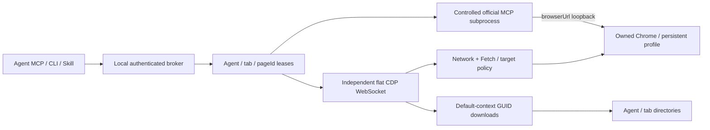
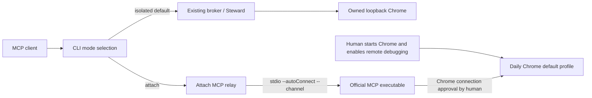

# Architecture

`0.3.0` is an MIT orchestration layer over the unmodified, Apache-2.0 [chrome-devtools-mcp 1.13.0](https://github.com/ChromeDevTools/chrome-devtools-mcp) executable. Its license and attribution ship in [NOTICE](../NOTICE) and [third_party](../third_party/chrome-devtools-mcp-LICENSE). Playwright is used only by tests and the historical probe.



## Browser support

Google Chrome current Stable or newer is required on every platform, including Linux headless=new, matching the [official requirements](https://github.com/ChromeDevTools/chrome-devtools-mcp#requirements). Official Lighthouse uses recent CDP commands such as `Network.emulateNetworkConditionsByRule`; passing core navigation/download tests on Chrome 136/146 does not establish support for the diagnostic toolset. Linux CI follows Google's Stable channel and records the actual installed version. No older-browser path, skipped diagnostic or alternative protocol implementation is maintained.

## Isolated ownership and lifecycle

`runtime.ts` owns Chrome processes, dedicated marked profiles, loopback endpoints and disk checks. `steward.ts` owns readiness, connection recovery, shutdown and adapter assembly. `session/owned-tabs.ts` owns the single lease map, capacity reservations, expiry, action busy state and trace ownership. `adapters/chrome/cookie-snapshot.ts` owns the CDP cookie projection used during recovery. Steward exposes the same lease map and forwards its existing public tab API. `devtools.ts` owns the installed upstream subprocess and the compatibility adapter. `cdp.ts` owns one independent browser WebSocket with flat `sessionId` command envelopes. `headers.ts` owns target policy and recursively attached child sessions; `downloads.ts` owns frame attribution and filesystem distribution. `broker.ts`, `cli.ts` and `mcp.ts` are authenticated entry points.

The supervisor starts Chrome with its own marked `stateDir/profile`, `--remote-debugging-address=127.0.0.1`, and a random port unless explicitly configured. A blank anchor keeps Chrome alive. It starts the pinned dependency's executable via the MCP SDK's controlled stdio transport, passing `--browserUrl`, `--pageIdRouting`, `--experimentalStructuredContent`, `--no-usage-statistics`, `--no-performance-crux`, and a workspace restricted to `stateDir`. It never invokes an unpinned runtime download or lets upstream launch another Chrome.

Opening a tab creates a blank target with a unique marker, attaches policy before any managed HTTP navigation, and obtains its official `pageId` from structured `list_pages`. UUID tab ownership, pageId, target and flat session belong to one lease. Every operation validates its agent before passing pageId to upstream. There is no global selected-page workflow. Existing tool names and `[ref=...]` snapshot syntax remain; refs contain upstream UIDs. CSS compatibility resolves accessible top-level elements through upstream snapshot/evaluation, then uses upstream click/fill. Popups and unowned pages are reclaimed; they do not acquire a lane.

Normal shutdown calls `Browser.close` and waits for process exit so persistent cookies reach disk. Killing Chrome immediately with a signal can lose recently written cookies even while localStorage survives. An unresponsive shutdown has a bounded process kill; it is logged. A later startup may close an orphan only after verifying the marked profile and command line.

CDP or official-process loss marks the service unavailable, stops the owned browser/subprocess, invalidates all leases, and reconnects both clients to the same persistent profile. An in-memory snapshot restores session cookies during recovery. Cookie changes since the last successful action/health scan may be lost; this snapshot does not survive a service restart. Persistent cookies and browser storage use Chrome's disk profile. No failed operation is replayed.

## Domain-filtered headers

The official `emulate.extraHttpHeaders` option is not exposed or used. It has page-wide semantics and cannot express an allowlist.

The independent outer connection enables Network and request-stage Fetch interception on each page/iframe session. Recursive `Target.setAutoAttach` pauses child iframe/dedicated-worker targets until their policy is installed. Each request removes the configured lane keys, then injects the owning tab's headers only if the destination hostname matches `headerDomains`. This repeats on redirects. Exact hostname entries and explicit `*.example.com` suffix entries have separate semantics; an empty list permits no headers.

Dedicated worker targets implement Network but not Fetch. Their fetch/XHR/import requests pass through the owning ancestor's Fetch interception. Network headers on a worker supply same-origin nested-worker startup scripts, which are not independently paused by page Fetch; these defaults are set only when the worker's own origin is allowlisted. Ancestor Fetch strips the lane keys on external requests. Tests include same-origin and external-frame nested workers, module imports, importScripts, script redirects and worker redirects. No browser-version/platform branch or alternate interception implementation is selected.

The official server and outer sessions are independent CDP clients on the same Chrome. Upstream observes requests and performs actions; only the outer layer mutates request headers. WebSocket, WebTransport, browser-system and extension traffic are outside this HTTP(S) guarantee. This is coordination between trusted agents, not a network firewall.

## Origin-wide worker policy

SharedWorker is disabled by `--disable-shared-workers`. ServiceWorker registration is rejected by a non-writable registration policy installed before page/iframe document scripts and before dedicated workers resume. Existing web ServiceWorkers reject startup; an unexpected origin-wide worker target invalidates the connection. Request interception additionally rejects registration scripts that enter the owned page pipeline.

ServiceWorker startup script fetching can precede the target's debugger pause. Merely attaching Fetch to a new ServiceWorker is too late: it can allow the initial script and background fetch through. Registration must be prevented at the page entry point. Synthetic tests assert registration rejection and zero `/sw`, `/shared`, or background requests at the server. Sites requiring offline caches, push or shared background workers are not supported. Pages that deliberately circumvent policy are outside the cooperating-agent trust model.

## Downloads and diagnostics

Browser-level `Browser.setDownloadBehavior` uses `allowAndName`, `eventsEnabled`, and a staging directory. Both it and `Browser.cancelDownload` omit `browserContextId`, selecting the persistent default context on every supported platform. A page target context ID is never supplied. This preserves the v0.1.1 Linux fix.

```text
stateDir/downloads/staging/<local-connection-uuid>/<download-guid>
stateDir/downloads/agents/<agent-id>/<tab-id>/<download-guid>-<safe-name>
```

Page/iframe frame IDs map each GUID to a lease. Finished files move only after validating Chrome's GUID staging path; unknown downloads are canceled. Closing a tab removes frame ownership, closes child sessions with the target and cancels unfinished downloads. Completed files persist; lists contain current-service completions. Disk limits reject new work and cancel active downloads; they never remove login data or finished downloads.

`browser_devtools` and CLI `devtools` expose a fixed set of official screenshot, network, console, CSS, Lighthouse and trace diagnostics, always injecting an owned pageId. Lifecycle tools, emulation header mutation and arbitrary upstream forwarding stay private. Network/console collectors remain page-scoped. Trace/Lighthouse recording is serialized browser-wide and uses bounded automatic stop. Insight lookup checks the latest trace owner because upstream retains its latest trace globally. Raw traces can contain events from the whole browser; they are not a tenant-isolated artifact.

## Daily Chrome attach

[ADR 0001](adr/0001-reject-self-built-extension-use-official-autoconnect.md) selects official autoConnect in place of the closed extension/native-host PoC. `mcp --mode attach` is a foreground stdio MCP adapter; `isolated` remains the default for every existing command/configuration. No broker or isolated config is loaded for attach.



`cli-mode.ts` validates the mode and rejects unsupported attach commands/options before any browser work. `attach/options.ts` owns channel/approval-budget validation. `upstream.ts` resolves/spawns the pinned executable for both modes; isolated retains its exact arguments. `attach/connection.ts` builds the official autoConnect flags and forces lazy connection with `list_pages`. A successful MCP handshake alone cannot report readiness. Official errors keep their cause text and gain actionable Chrome 144+, remote-debugging and Allow-dialog instructions. Ambiguous official errors are not classified as definite refusal/version failures.

`attach/server.ts` owns one official subprocess and a transparent tools/list + tools/call relay. Official schemas, page IDs, results, images and tool errors pass through without our compatibility action adapter. Request cancellation is forwarded. Stderr reports waiting for authorization before attachment and connected after the probe. Bounded startup failure or official subprocess loss terminates the session; EOF/signals close the relay/subprocess. It never calls `Browser.close`, starts/restarts Chrome, removes tabs or retries failed actions. Official upstream disconnects from a connected browser on shutdown, leaving the daily Chrome open.

Attach constructs no `Steward`, `OwnedTabs`, `TabPolicy`, `Downloads` or independent CDP client, and writes no state/profile directory. Lane headers, tab/pageId leases and profile/download isolation are unavailable; requesting isolated CLI options is an error. Official tools retain browser-wide and page-wide powers in the default profile and all its windows. That profile is not a tenant boundary. No custom extension, profile discovery, old-browser fallback or second action/download backend is implemented. Remote-debugging enablement and each Chrome approval remain the human's responsibility.

## Trust boundary

The isolated control plane uses a permission-protected Unix socket and scoped agent tokens. State directories use 0700 and socket/admin files use 0600. CDP binds to loopback. OS users/processes with direct CDP or administrator-token access have browser-wide power. Cookies, localStorage and IndexedDB are shared intentionally; logging out affects all agents. Logs omit cookie/header values and query/hash, but paths may still be sensitive.
