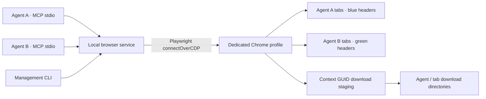

# Architecture

Each MCP client owns a set of tabs in one persistent Chrome browser. Playwright connects over CDP to the browser's default context, so clients share cookies and same-origin storage.



## Service lifecycle

`mcp`, `open`, and `launch` start the service if needed. A broker lock elects one startup owner; simultaneous clients wait for that service to become ready. Startup configuration is sent over Node IPC, rather than exposed in process arguments. Each data directory supports one service.

The service keeps a blank anchor tab open so the browser window and download lifecycle remain available when all agent tabs close. Do not use or close the anchor as an agent tab. Closing it triggers browser recovery.

Tab ownership, leases, and per-tab request policy live in `src/steward.ts`; Chrome process and disk management in `src/runtime.ts`; downloads in `src/downloads.ts`; local authentication in `src/broker.ts`; startup coordination in `src/supervisor.ts`. CLI and MCP entry points call those owners.

On a CDP disconnect, actions fail until the service restarts its own Chrome process and reinstalls request policies. Existing tab leases are released. The profile remains, and the in-memory cookie snapshot restores session cookies. Cookie changes since the last successful action/health scan can be lost; the in-memory snapshot does not survive a service restart.

A later launch can recover a killed service's orphan browser only after verifying the dedicated profile and Chrome command line. It never kills an arbitrary Chrome PID or attaches to a daily browser profile.

## Header isolation

A page's extra HTTP headers cover its page and child targets. Context request routing then merges the owning tab's headers, overriding conflicting page-supplied values. Routing is installed before managed navigation, disables HTTP caching, and rejects requests without a managed page owner. Popups and unmanaged tabs are closed; create tabs with `browser_tabs` instead.

Validated request types: documents, stylesheets, scripts, images, fetch, XHR, beacon, navigation, same-origin and cross-origin iframes, dedicated and nested workers, and downloads. WebSocket handshakes, WebTransport, browser system traffic, and extension networking are outside this guarantee.

## Worker policy

SharedWorker and ServiceWorker have origin-wide lifetimes. They cannot unconditionally be assigned the headers of one tab when multiple tabs use different headers.

The implementation therefore uses an explicit blocking policy:

1. Launch Chrome with `--disable-shared-workers`.
2. Abort any request owned by a ServiceWorker, any worker registration/update script identified by `Service-Worker: script`, and requests whose `Sec-Fetch-Dest` is `serviceworker` or `sharedworker`.
3. Reject startup if an existing web ServiceWorker is detected. Built-in extension workers are outside site origin handling; extensions are disabled at launch.
4. Restart owned Chrome after a CDP disconnect, instead of continuing existing tabs without interception.

There is no switch to preserve shared/background workers. Supporting sites that need them would require a separate origin-wide single-preset scheduler and full lifecycle validation. In-flight requests during a lost CDP connection cannot be undone; this is not a network firewall.

## Downloads and disk usage

Downloads are staged using a local UUID for each default-context connection and Chrome's download GUID:

```text
stateDir/downloads/staging/<context-guid>/<download-guid>
stateDir/downloads/agents/<agent-id>/<tab-id>/<download-guid>-<safe-name>
```

The download event's frame ID maps to its page and agent. Completed files are moved only after validating their staging path. Unknown frame downloads are canceled. Duplicate completion events are idempotent; cross-origin frame swaps retain ownership. Closing a tab cancels unfinished downloads. Completed files persist; the MCP list contains completions from the current service lifetime.

The service uses a browser-level CDP session and the persistent default context. Both `Browser.setDownloadBehavior` and `Browser.cancelDownload` omit `browserContextId`: [CDP specifies that omission selects the default context](https://chromedevtools.github.io/devtools-protocol/tot/Browser/#method-setDownloadBehavior). A page target's reported context ID is not used as a download-command context ID. The local staging UUID is only a filesystem namespace; download isolation comes from GUID naming and frame/page/agent attribution.

Free space and download size are checked at startup, before opening tabs, and periodically. The soft limit rejects new work and cancels active downloads until space is available. It never deletes completed downloads or login data. Use filesystem quotas for a hard storage limit.

## Trust boundary

The control plane uses a permission-protected Unix socket and scoped agent tokens. CDP binds to `127.0.0.1`. A process that can read the administrator token or connect directly to CDP has browser-wide access. Use this tool between trusted agents under a dedicated OS user, not as tenant isolation.

Cookies, localStorage, IndexedDB, and other same-origin state are shared. Custom headers do not isolate application data stored there. Logs contain tab IDs, agents, header fingerprints, and request matches, but omit cookie/header values and URL query/hash. URL paths may still be sensitive.

Protocol references: [Playwright CDP](https://playwright.dev/docs/api/class-browsertype#browser-type-connect-over-cdp), [ServiceWorker routing](https://playwright.dev/docs/service-workers), [Chrome download events](https://chromedevtools.github.io/devtools-protocol/tot/Browser/).
