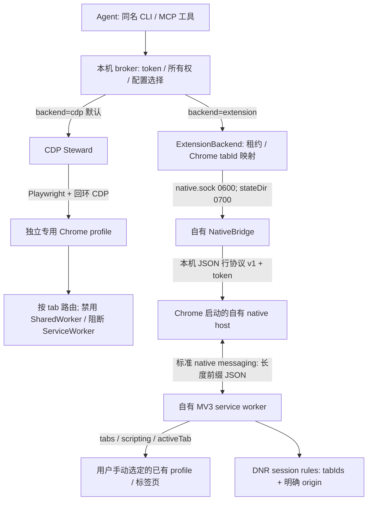

# 自有扩展 backend PoC

版本：`0.2.0-extension-poc.1`。默认仍为 CDP；`v0.1.0` 的 tag、GitHub npx 入口和 CDP 使用方式保留。扩展、宿主和协议源码均在本仓，以 MIT 提供。没有商店发布、自动更新、遥测、远程服务器或浏览数据上传。

## 定位与边界

扩展运行在用户**自行选择并手动加载**的 Chrome profile 中，复用该 profile 已有的登录会话。它不读取 Cookie 数据库、不导出凭据、不启动 Chrome、不打开调试端口，也不安装到浏览器。**日常浏览器、单泳道、免重登**是扩展模式的定位；**多泳道并行仍使用 CDP**。

扩展不会关闭或接管未选择的已有标签页。`available` 返回所有窗口的 tab 元数据（包含 windowId），`attach` 显式租用一个 Chrome tabId；返回的 UUID 是后续工具使用的 tabId。已被其他 agent 租用的 tab 不可重复租用。MCP 退出/租约过期时，解除已有 tab 的规则并保留页面；工具新建的 tab 会关闭。显式 `browser_close` / tabs close 会关闭目标页面，包括主动 attach 的页面。

浏览器的 Cookie、localStorage、IndexedDB、ServiceWorker 和 SharedWorker 仍由同一个 profile/origin 共享，**不提供多账号隔离或租户隔离**。页面内容会返回本机调用方，并可能进入调用方自己的记录。权限覆盖的站点可能有敏感内容，授权和 attach 应由可信用户/Agent 完成。

## 两 backend 架构



代码入口：`src/backend.ts` 定义 broker 消费的接口；`src/steward.ts` 实现 CDP；`src/extension-backend.ts` 实现扩展租约；`src/native-bridge.ts` 管 socket 会话与命令关联；`src/native-host.ts` 管标准 native messaging framing；`extension/background.js` 管扩展连接、DNR 与 Chrome API；`extension/page.js` 在隔离世界内执行 DOM 操作。

宿主协议仅接受固定浏览器操作和响应，不提供执行 shell、读任意文件、任意 JS eval 或网络转发命令。页面没有到宿主的开放接口，manifest 没有 externally_connectable 或 web-accessible resources。

## 安装：手动加载 + 显式安装 manifest

需要本机已有 Node.js 22+ 和 Chrome。先安装源码依赖并构建；以下命令不需要管理员权限，不发布 npm 包。

```zsh
git clone https://github.com/Tsutomu-miku/cdp-browser-mcp.git
cd cdp-browser-mcp
git checkout extension-backend-poc
npm ci
npm run build
```

1. 生成一个**新目录**，只列出实际要使用的 HTTP(S) origin。精确到 scheme/host/port，不带路径或结尾 `/`；页面、iframe 和子资源涉及的其他 origin 也需明确列出。不要直接把范围扩大到所有站点。

```zsh
node scripts/extension-setup.mjs prepare \
  --output "$HOME/cdp-browser-poc-extension" \
  --origins '["https://example.com","https://assets.example.com"]'
```

2. 由用户在自己选择的 profile 打开 `chrome://extensions`，开启“开发者模式”，点击“加载已解压的扩展程序”，选择刚才的目录。记录显示的扩展 ID（32 位 a–p）。这一步不由 CLI 自动完成。PoC 测试一律用独立 `--user-data-dir`；不要把测试命令用于日常 profile。

3. 在 `chrome://version` 查看“个人资料路径”，取它的**父目录**作为 user-data-dir（不要传 `Default` 或 `Profile 1` 子目录）。显式安装标准 native manifest：

```zsh
node scripts/extension-setup.mjs install-native \
  --extension-id '<chrome://extensions 中的 ID>' \
  --state-dir "$HOME/.local/state/cdp-browser-extension" \
  --browser-user-data-dir '<你明确选择的 Chrome user-data-dir>'
```

脚本仅在给定 user-data-dir 的 `NativeMessagingHosts/` 创建 `io.github.tsutomu_miku.cdp_browser_mcp.json`，并在 stateDir 创建 Node 启动器；不会修改页面、登录数据或扩展安装记录。已有 manifest 会报错而非覆盖。执行前检查输出目标；日常 profile 的这项写入须由用户自己决定并手动执行。路径含空格可正常传参，Node 可执行文件本身的路径需不含空白。stateDir 的 Unix socket 完整路径最长 100 字节。

4. 写配置（将 ID 替换为实际值；stateDir 需与安装命令一致，且和 CDP 分开）：

```json
{
  "backend": "extension",
  "extensionId": "aaaaaaaaaaaaaaaaaaaaaaaaaaaaaaaa",
  "stateDir": "/absolute/path/to/extension-state",
  "actionTimeoutMs": 15000,
  "lanes": { "default": {} }
}
```

5. 启动、检查健康、列出并租用已有 tab：

```zsh
node dist/cli.js launch --config /absolute/path/extension.json --json
node dist/cli.js status --config /absolute/path/extension.json --json
node dist/cli.js available --config /absolute/path/extension.json --agent task-123 --json
node dist/cli.js attach --config /absolute/path/extension.json --agent task-123 --chrome-tab 123 --json
node dist/cli.js snapshot --config /absolute/path/extension.json --agent task-123 --tab '<返回的 UUID>'
node dist/cli.js headers --config /absolute/path/extension.json --agent task-123 --tab '<UUID>' --headers '{"x-lane":"blue"}'
node dist/cli.js headers --config /absolute/path/extension.json --agent task-123 --tab '<UUID>' --headers '{}'
node dist/cli.js reclaim --config /absolute/path/extension.json --agent task-123
node dist/cli.js stop --config /absolute/path/extension.json
```

`launch` 只启动本机 broker；`ready=false` 表示扩展尚未连上，后续请求仍会等待连接，而非永久失败。扩展目录移动或重新生成可能改变扩展 ID，需要匹配的 manifest/config。更新源码后重新构建，用户在扩展管理页手动“重新加载”；没有自动更新通道。

卸载：先停止该配置的 broker，在用户选择的 profile 中移除扩展，按安装脚本输出删除该 manifest 和 native-launcher.mjs。用户登录数据与其余浏览器数据保留。测试 profile 由用户按需处置。

## MCP 示例

```json
{
  "mcpServers": {
    "browser": {
      "command": "node",
      "args": [
        "/absolute/path/cdp-browser-mcp/dist/cli.js",
        "mcp",
        "--config",
        "/absolute/path/extension.json",
        "--agent",
        "task-123",
        "--headers",
        "{\"x-lane\":\"blue\"}"
      ]
    }
  }
}
```

从 GitHub 预发布分支运行也可把 command/args 改为 `npx --yes github:Tsutomu-miku/cdp-browser-mcp#extension-backend-poc mcp --config ... --agent ...`。native host 必须指向稳定的源码构建目录，不应指向会被缓存回收的临时 npx 目录。

Agent 调用 `browser_tabs({action:"available"})` 得到 Chrome tabId，再用 `browser_tabs({action:"attach",chromeTabId:123})`。后续同名工具为 `browser_navigate`、`browser_click`、`browser_type`、`browser_snapshot`、`browser_extract`、`browser_take_screenshot`、`browser_tabs`、`browser_close`、`browser_lease`。不 attach 时，首次页面操作创建一个新 tab。

`browser_tabs({action:"headers",headers:{...}})` 替换当前 tab 的完整头集合，`headers:{}` 删除。`browser_tabs({action:"new",headers:{...}})` 和 CLI `open` 继承配置泳道。Cookie、Authorization、Host、Content-Length 等身份/hop-by-hop 头不属于本 PoC 可注入范围。

## 权限与工具差异

| 权限/能力                           | 理由与限制                                                                                                                                                                                    |
| ----------------------------------- | --------------------------------------------------------------------------------------------------------------------------------------------------------------------------------------------- |
| 明确的 host_permissions             | 只覆盖用户生成目录时列出的站点，无 `<all_urls>`、无任意 host 通配授权。Chrome match pattern 无法限制端口；DNR regex 和页面操作再校验精确 origin（端口仍会出现在 Chrome 的 host 权限范围中）。 |
| tabs                                | 列出各窗口 tab ID、URL、标题，支持明确选择。此权限可见所有 tab 元数据，但页面内容还受 host allowlist 限制。                                                                                   |
| scripting                           | 只在请求的授权 tab 顶层 frame 注入自有 page.js，ISOLATED world。无自动全站 content script。                                                                                                   |
| declarativeNetRequestWithHostAccess | `modifyHeaders` 只对 session rule 指定 tabId、授权请求 origin 生效。不会生成全局或 tabId=-1 规则。                                                                                            |
| nativeMessaging                     | 只连上述自有 host；manifest 只允许一个精确扩展 ID。                                                                                                                                           |
| activeTab                           | 截图前须激活目标 tab，并由用户点击扩展工具栏按钮。未授权时报错；不会替用户切换页面或获取全站截图权限。只截可见视口，JPEG，响应有大小上限；截图期间切换 tab 会丢弃结果。                       |
| alarms                              | 断连后的重试唤醒；native port 存活时另有心跳。                                                                                                                                                |
| DOM snapshot                        | 提供带 ref 的 DOM 语义摘要，非完整 AX 树。限顶层文档；不遍历 Shadow DOM/跨源 frame。导航后的 ref 失效，重取 snapshot。                                                                        |
| click / type                        | DOM click、原生 value setter + input/change 事件；不承诺 trusted 键盘/鼠标事件。`slowly` 明确不支持；submit 用 form.requestSubmit。依赖原生事件的复杂控件继续走 CDP。                         |
| 下载                                | 扩展 PoC 不接管或归属下载，下载留在 Chrome 原配置目录；`browser_downloads` 明确报不支持。                                                                                                     |

没有 cookies、history、debugger、proxy、webRequest、可选全站权限或后台站点 fetch。测试用**独立观察器扩展**额外申请 webRequest 以记录 tabId，观察器不包含在交付扩展或安装流程中。

## DNR 与 worker 的真实边界

**已实测（macOS arm64，Chrome for Testing 有头）**：两个 tab 各自的主文档、CSS、script、image、fetch、XHR、beacon、iframe、iframe fetch、DedicatedWorker 脚本及其 fetch 不串头；同一个 tab 动态替换/删除规则有效；关闭 tab 后对应规则删除。两个 tab 不同泳道仅用于诊断覆盖边界，**不是多泳道安全保证**。

**已实测**：ServiceWorker 的后台 fetch、通过 onfetch 转发到另一 URL 的 fetch、SharedWorker fetch，以及扩展后台 fetch，在观察器中为 `tabId=-1`，服务器收到的泳道头为空。ServiceWorker 脚本请求本身也为 tabId=-1、无头；SharedWorker 初始脚本请求归属于首次创建它的 B tab，带 green 头，但之后 A/B 共用的 worker fetch 均为 -1、无头。引导脚本和 worker 后续请求的覆盖不能混为一谈。SW 直接合成的 `/sw-cache` 响应没有网络请求，服务器没有该条记录。用户页面发起的请求和 worker 实际转发的请求不可混为一谈。

**实现限制**：只按具体 tabId 注头，不注 worker/后台全局头，不阻断日常 profile 中的 worker，不清空它们的 CacheStorage 或注册。已有缓存、worker、其他扩展和页面自身 header 均可能影响结果；本插件不清除页面自己设置的同名头，也无法凭空把 origin 级 worker 归属某个 tab。若站点依赖这些后台请求也走泳道，扩展 PoC 不提供完整覆盖，应使用 CDP 的明确 worker 阻断策略。WebSocket、WebTransport、浏览器内部流量和其他扩展流量不在注头保证内。

**文档依据**：[Chrome DNR 文档](https://developer.chrome.com/docs/extensions/reference/api/declarativeNetRequest) 规定 tabIds 仅用于 session rules，-1 表示无 tab；DNR 只影响进入网络栈的请求，不能改写 SW 直接生成或 CacheStorage 返回的内容。**推断**：不同站点/Chrome 版本的具体 worker 路径可能有差异，因此需要按目标站点重新抓请求验证，不能把本合成站结果推广到所有站点。

## 健康检查、恢复与安全

- stateDir `0700`；native.sock / control.sock、token 文件与 manifest `0600`；启动器 `0700`。全部本机 Unix socket，无公网/回环 HTTP 服务。相同 OS 用户可读 token，不能用作不可信租户之间的隔离。
- native host 校验 Chrome 传入的精确调用扩展 origin；socket 握手还校验协议版本、扩展 ID 和独立随机 token。帧大小、命令名、tab ID、头名/值有边界校验。
- broker 每 2 秒探测；扩展 native 心跳每 5 秒，15 秒无消息判失联；断线指数退避 250ms–10s，alarms 补充唤醒。清除断连规则后，新 host 恢复有效 tab 租约的头规则，再标记 ready。
- 超时打断失效通道；后续请求可重新连接。**不自动重放导航/点击/输入**，超时/断连时操作结果可能未知，调用方应先读取页面确认。旧请求晚到响应不会当作新请求。
- **已实测**：SIGKILL native host 后进程 PID 和连接 generation 改变，原 tab 无需重开即可继续，后续请求头恢复；故意让导航不结束触发 action/health 超时后，后续请求也恢复，导航只发出一次。另强制关闭扩展 worker target 后，持久 alarm 唤醒新 worker，并从 broker 恢复 tab 规则；后续请求头仍正确。
- **文档说明**：恢复期间页面和既有 worker 仍可自主发请求；清规则到重建之间可能无泳道头。此后端不是网络防火墙，也不保证断连期间拦截流量。broker 崩溃后内存租约丢失，新 broker 清理旧 session rules，不接管未知旧 tab；之前由工具新建的 tab 可能留下供用户关闭。

## 验证与跨平台状态

可重复验证命令（只使用你已安装的测试浏览器，不自动下载系统依赖）：

```zsh
POC_CHROME_PATH='/absolute/path/to/Chrome for Testing' \
POC_TEST_ROOT='/absolute/path/to/test-artifacts' \
npm run test:extension
```

它会创建独立 user-data-dir、生成单独扩展副本、只在该目录安装 native manifest，运行本地合成 HTTP 站并输出 `test-results/extension-headed/`。测试 harness 的 CDP 仅用于创建测试环境、填写合成登录表单、触发工具栏 activeTab 及读取测试观察器；**被测 Agent 操作从 MCP 经 native host 到扩展，不经 CDP**。测试表单由自动化填写，不声称是真人人工登录。浏览器/服务器在退出时关闭，合成 profile 保留供本机复查。

| 平台                                      | 状态                                                                                        |
| ----------------------------------------- | ------------------------------------------------------------------------------------------- |
| macOS arm64 + Chrome for Testing 148 有头 | 已实测完整扩展/native/MCP 链路、请求头、worker 边界、截图、kill 和超时恢复。                |
| macOS 日常 Google Chrome profile          | 仅提供手动加载说明，未触碰或验证真实 profile。Chrome 的开发者模式手动加载方式属于文档依据。 |
| Linux / Linux 有头 / 无头                 | Unix host 与安装路径已实现，未运行扩展 E2E；不声称通过。                                    |
| Windows                                   | 本 PoC 未实现命名管道/注册表安装器，明确不支持。                                            |
| 其他浏览器、其他架构                      | 未验证。                                                                                    |

交付证据见 [扩展请求级验证记录](validation/extension-poc/README.md)。标准 native manifest 位置与 framing 依据 [Chrome native messaging](https://developer.chrome.com/docs/extensions/develop/concepts/native-messaging)；截图授权依据 [Chrome tabs.captureVisibleTab](https://developer.chrome.com/docs/extensions/reference/api/tabs#method-captureVisibleTab)。

## 公开技能参考复核

本轮参考 [chrome-extensions 的 MV3 指导](https://github.com/GoogleChrome/modern-web-guidance/blob/main/skills/chrome-extensions/SKILL.md)，重点核对同步顶层事件注册、隔离世界、CSP、明确 host 权限、用户手势和 [worker 生命周期](https://github.com/GoogleChrome/modern-web-guidance/blob/main/skills/chrome-extensions/references/extensions/service-worker.md)。只阅读指导，不复用其实现代码或增加运行时依赖。

租约与头配置的权威在本机 broker 和浏览器 DNR session rules；扩展的 port、串行队列和短时重试句柄均可丢弃重建。native port 活着时，短时 timer 负责通道心跳；持久 alarm 负责 worker 回收后的唤醒，不依赖 timer 跨 worker 存活。已增加强制终止 worker 的真实 E2E 验证，没有为可重建的 transport 对象新增 storage 权限。

`modern-web-guidance` CLI 使用 `DISABLE_TELEMETRY=1`，检索了 extension service worker lifecycle 与 service worker alarms；结果没有适用的 worker/alarms 专题，因此未套用无关 Web UI 指南，也没有引入该 CLI 为项目依赖。
