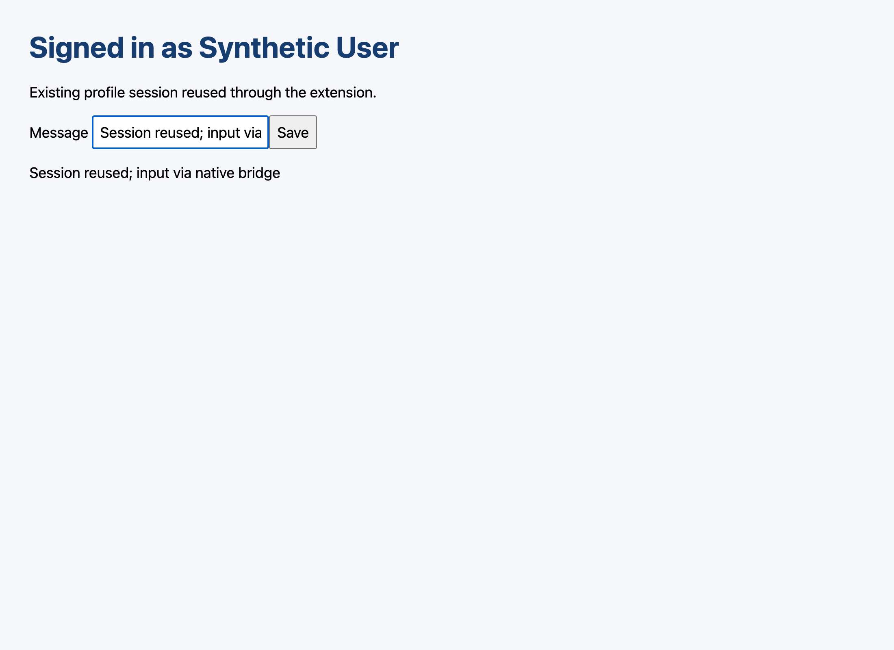

# 扩展 PoC 请求级证据

采集时间：2026-11-14T17:57:18.036Z；macOS arm64，Chrome for Testing 148.0.7778.96，Node.js 22.17.0，Playwright 1.65.1，有头。所有数据来自独立测试 user-data-dir 和本地合成站，无真实账号。登录表单由测试 harness 填写并提交，然后 MCP attach 读取已有会话；不声称人工登录或日常 profile 验收。

- [完整请求、Chrome tabId 观察与健康恢复 JSON](report.json)
- [通过扩展截图工具返回的登录后截图](session-reuse.jpg)
- 可重复源码：`test/extension.e2e.ts`、`test/extension-site.ts`、`test/native-protocol.test.ts`。

| 检查             | 已实测结果                                                                                                 |
| ---------------- | ---------------------------------------------------------------------------------------------------------- |
| 复用登录态       | 登录 POST 只发生于 attach 之前；MCP 读到 Signed in as Synthetic User，并完成 ref 输入和按钮点击。          |
| A tab 头隔离     | 11 个普通页面/子资源请求为 blue / alpha。                                                                  |
| B tab 头隔离     | 11 个普通页面/子资源请求为 green / beta。                                                                  |
| 错头             | 0；覆盖主文档、CSS、script、image、fetch、XHR、beacon、iframe、frame fetch、DedicatedWorker 脚本和 fetch。 |
| 动态替换/删除    | changed 请求为 amber 且原 x-poc 消失；removed 请求无 x-lane。                                              |
| tab 关闭         | rulesBeforeClose / rulesAfterClose 记录相应 Chrome tabId 的规则被移除。                                    |
| Worker/后台      | 7 个 SW 后台/转发、SharedWorker fetch、扩展后台 fetch 在观察器中为 tabId=-1；服务器实际收到 lane=null。    |
| native host 被杀 | PID 79019 → 79046；generation 1 → 2；after-reconnect 请求继续为 blue。                                     |
| 超时后恢复       | PID → 79083；generation → 3；after-timeout 请求为 blue；/stall 导航只发送 1 次，无重放。                   |
| 权限             | stateDir 0700；native.sock、control.sock、native.json、admin.json 为 0600。                                |
| 清理             | MCP 退出保留 attach 的原页面，工具新建 tab 被回收；测试关闭其浏览器和本地站点。                            |

**不能只看脚本请求推断 worker 的隔离性：** 本次 SharedWorker 的初始 `/shared.js` 归属 B 的 tabId 并带 green；它为 A/B 发出的 fetch 均为 -1、无头。ServiceWorker 的 `/sw.js` 本身就是 -1、无头。SW 合成的 `/sw-cache` 响应不触及服务器。扩展仅用于单泳道，不能把两 tab 普通资源实验当作多泳道安全承诺。

**其他验证：** `STEWARD_HEADED=1 npm test` 的原有 4 个 CDP 场景和 2 个 native 协议场景全部通过；后补的安装器重复安装拒绝检查也通过（原 manifest/launcher 字节保持不变）。`npm run build`、格式与 diff 检查通过。公开 GitHub `v0.1.0` 的真实 npm exec/npx 接入返回 `0.1.0`，未改 tag，未发布 npm。

**如实保留未通过/未验证范围：** 额外把原有 CDP 套件指向本机较旧 Chrome for Testing 148 时，4 个场景均在 CDP 端点启动阶段超时；未对该环境做根因归因或兼容承诺。默认 CDP 使用本机 Chrome 157 的有头回归全部通过。扩展在 Chrome for Testing 148 有头通过不等于其 CDP 启动通过。Linux/无头扩展未跑；Windows 未实现；日常 Chrome profile 未触碰。native 心跳 watchdog 机制已实现，SIGKILL 与普通操作/health 超时恢复已测，冻结进程 SIGSTOP 场景未单独验证。

